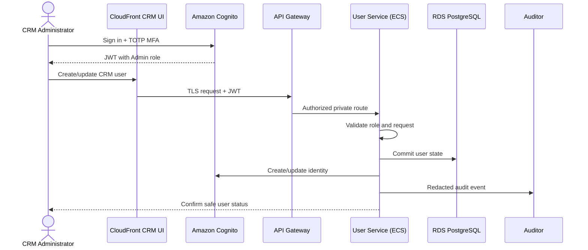
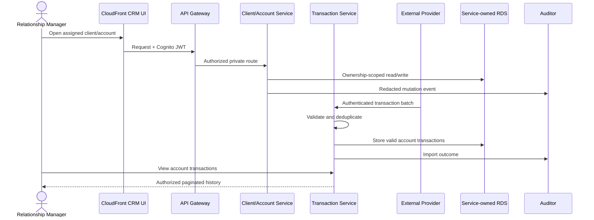
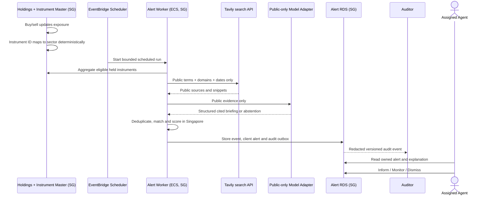

# Stakeholders and Architecturally Significant Requirements

> Status: Accepted with the target architecture (2026-11-01). The solution view
> covers the CRM baseline and the Event-Driven Client Alerts design; the alert
> ADRs are accepted, and the live AWS evidence listed at the end is still to be
> collected.

## Solution View

The CRM is deployed as a single-legal-entity workload in the AWS Singapore
Region, across two Availability Zones. Two outbound calls carry data beyond
Singapore, both public-data only: the alert worker's news search through the
third-party Tavily API, and its model call through a global inference profile.
The health monitor's wording requests carry banded facts through an Asia-Pacific
inference profile, so they stay in Asia-Pacific. Business users
authenticate to the application; they are not given AWS console credentials.

### AWS services and system components

| Service or component | Purpose in the solution |
|---|---|
| Amazon CloudFront | Delivers the CRM single-page application and provides the same-origin `/api/*` entry path. |
| Amazon Cognito | Authenticates Admin and Agent users, enforces TOTP MFA, issues JWTs, and supplies application role claims. |
| Amazon API Gateway HTTP API | Validates Cognito tokens at the public API boundary, routes requests to the owning service through private integration and applies stage throttling. |
| Amazon ECS on AWS Fargate | Runs the CRM APIs and the Event-Driven Client Alerts API/worker containers without managing servers. Tasks are distributed across two Availability Zones. |
| AWS Cloud Map | Provides private service discovery for API Gateway integrations and internal service endpoints. |
| Amazon RDS for PostgreSQL | Stores service-owned CRM and alert data. Existing CRM services use isolated databases; the alert database topology must be confirmed before staging. Multi-AZ and encryption at rest are required for CRM records. |
| Amazon EventBridge Scheduler | Starts the bounded Event-Driven Client Alerts worker on its approved schedule. |
| Tavily search API (third party, outside AWS) | Performs allowlisted searches for public regulatory, exchange and issuer news, called directly from the alert worker with an API key from Secrets Manager. It receives public terms only and never receives client or portfolio data. It replaced the planned Amazon Bedrock AgentCore web search in Tokyo, which an AWS Organization service control policy blocks ([ADR-0050](../adr/ADR-0050-event-search-provider-after-scp-block.md)). |
| Amazon Bedrock model adapter | Classifies public events and produces a source-grounded, AI-labelled market briefing from public evidence only, with Amazon Nova 2 Lite through its global inference profile, called from Singapore. Model invocation remains default-off until its safety and quality gates pass. |
| Existing auditor and Kafka contract | Receives versioned, redacted audit events through the alert service's transactional outbox. No new alert-specific broker is introduced. The auditor's AWS hosting choice must remain aligned with the platform design. |
| Amazon CloudWatch | Collects redacted logs, metrics, dashboards and alarms for API health, schedules, search/model usage, audit backlog and operational failures. |
| AWS Key Management Service (AWS KMS) | Supplies encryption keys for supported data stores and service-managed encryption at rest. |
| AWS Secrets Manager | Stores database and provider credentials; secrets are injected at runtime and are not committed to source control. |
| AWS Identity and Access Management (IAM) and IAM Identity Center | Provide least-privilege workload roles, CI/CD federation and controlled human AWS administration. IAM is not the CRM's end-user authorization system. |
| AWS Budgets and billing alarms | Enforce early warnings against the USD 300 project hard limit, the USD 100 protected contingency, and the alert feature's lower cost limits. |
| External transaction provider | Supplies synthetic account transactions to the transaction-ingestion feature through its approved machine-to-machine contract. It is outside the CRM trust boundary. |
| Instrument master | Maps a stable instrument identifier deterministically to public ticker, issuer, asset class, sector and industry data. The MVP uses synthetic reference data in Singapore. |

### Identity and trust boundaries

- **CRM Admin and Agent:** authenticate through Cognito and receive application
  permissions from validated JWT claims. They do not require IAM users.
- **AWS operators and developers:** use IAM Identity Center or short-lived
  federated roles rather than shared, long-lived IAM access keys. The team's
  account cannot use Identity Center, so operators take an MFA-protected,
  4-hour role from IAM users whose keys can reach nothing else
  ([ADR-0046](../adr/ADR-0046-human-deploy-access-mfa-role.md)).
- **Workloads:** use separate ECS task/execution roles with only the actions and
  resources required by that service.
- **CI/CD:** assumes a narrowly scoped deployment role through workload identity
  federation; it does not store permanent AWS keys.
- **Tavily search and global model inference:** receive public market information
  only. Client identity, account, holding, exposure, agent, internal-note and
  audit data remain in Singapore.

## Understanding of the Stakeholders

The permissions below distinguish **application permissions** from **AWS
permissions**. Giving every business stakeholder an IAM user would unnecessarily
expand the AWS attack surface; application users therefore use Cognito, while
only platform responsibilities receive AWS roles.

| Stakeholder | Stakeholder description | Required application and AWS permissions |
|---|---|---|
| CRM Administrator | Manages CRM users and provides operational oversight. The alert feature gives Admins read-only visibility across alerts. | Cognito `Admin` application group; create, view, update, activate and deactivate approved CRM users; read operational and alert oversight views. No AWS console access by default and no permission to make an Agent's client-alert decision. |
| Relationship Manager / Agent | Onboards and maintains assigned clients, manages their accounts, reviews imported transactions and acts on relevant alerts. | Cognito `Agent` application group; read/write only assigned client and account records; read their transactions and alerts; submit `INFORM_CLIENT`, `MONITOR` or `DISMISS` decisions for owned clients. No AWS console access. Repository queries must enforce ownership. |
| Client | Bank customer represented in the CRM. The client benefits from better-prepared relationship conversations but does not directly operate this back-office application. | No Cognito or IAM identity in the current scope. Client data is accessible only through authorized Admin/Agent workflows and must remain encrypted and audited. |
| Compliance / Internal Auditor | Reviews evidence that privileged actions, data access and AI-assisted alerts are controlled and traceable. | Application or federated read-only audit role; read redacted, immutable audit events and approved operational reports. If AWS access is required, use a read-only IAM Identity Center role limited to CloudWatch/audit evidence, with no data mutation, secret retrieval or role-assumption administration. |
| Platform / Cloud Administrator | Deploys, configures, monitors and recovers the AWS environments. This is separate from the CRM Admin business role. | MFA-protected IAM Identity Center platform role; least-privilege access to the approved ECS, API Gateway, CloudFront, Cognito, RDS, Cloud Map, EventBridge, CloudWatch, KMS, Secrets Manager and budget resources. Production changes should use controlled elevation and audit logging. No routine access to plaintext business data. In the team's account: the role `crm-infra-admin`, with administrator rights and MFA ([ADR-0046](../adr/ADR-0046-human-deploy-access-mfa-role.md)). |
| Development and CI/CD Team | Builds, tests and promotes application and infrastructure changes through the repository workflow. | Developers use scoped non-production roles. CI/CD uses an OIDC-federated deployment role restricted by repository, branch/environment and resource tags. No long-lived AWS keys, direct production database access or permission to bypass protected promotion gates. |
| Alert Scheduler and Worker | System actor that discovers public events, classifies them and produces candidate client alerts. | Dedicated ECS task role: read its approved configuration/secret, access only its alert database, emit approved metrics/logs, read the Tavily API key, invoke the pinned Bedrock inference profile, and publish the versioned auditor envelope. Explicit deny-by-omission for unrelated tools, databases and domains. |
| External Transaction Provider | External synthetic system that supplies account transactions for Feature 3. | Narrow machine-to-machine permission to the approved ingestion contract only. It cannot query CRM users, clients, alerts, databases, secrets or AWS administration APIs. Requests must be authenticated, validated and auditable. |
| Product Owner / UBS Reviewer | Confirms that workflows, controls and innovation value satisfy the business need and proposal criteria. | Demonstration/read-only access to synthetic dashboards and approved evidence. No AWS mutation permissions or access to secrets. |

## ASR 1 — Admin Perspective

| Field | Details |
|---|---|
| **Use Case Title** | Secure Administration of CRM Users |
| **Use Case ID** | UC-01 |
| **Description** | A CRM Administrator securely creates or updates an Admin/Agent user while MFA, least privilege, encrypted storage and an auditable change history are enforced as part of the same workflow. |
| **Actors** | CRM Administrator, Amazon Cognito, CloudFront, API Gateway, User Service on ECS, RDS PostgreSQL, auditor, CloudWatch |
| **Pre-conditions** | The Administrator is active, enrolled in Cognito TOTP MFA, assigned the `Admin` application role and signed in over TLS. The User Service and auditor are healthy. |
| **Post-conditions** | The user record and required Cognito state are consistent; the least-privilege application role is effective; an audit event records the actor, action, target, timestamp and outcome without secrets; no plaintext credential is stored by the CRM. |

### Main flow of events

1. The Administrator signs in through Cognito and completes TOTP MFA.
2. CloudFront sends the same-origin API request to API Gateway, which validates
   the Cognito JWT and applies throttling.
3. The User Service independently validates the token and confirms the `Admin`
   application role; role claims are never accepted from request parameters.
4. The Administrator enters the new user's approved profile and selects an
   application role.
5. The User Service validates uniqueness, required fields and allowed role
   transitions, then updates its encrypted PostgreSQL database.
6. The identity adapter creates or updates the Cognito identity without storing a
   password in the CRM. Cognito requires MFA enrolment on first sign-in.
7. The service emits a redacted audit event containing the change outcome and
   correlation ID. CloudWatch records operational success/failure metrics without
   logging credentials or unnecessary personal data.
8. The UI confirms completion and displays the user's current non-sensitive
   status.

### Alternative flows of events

- **Invalid or expired token:** API Gateway or the User Service returns `401`; no
  user state changes.
- **Authenticated non-Admin:** the User Service returns `403`, records the denied
  attempt and exposes no administration data.
- **Duplicate or invalid user data:** validation returns a safe `4xx` response;
  the database remains unchanged.
- **Cognito or database failure:** the operation fails without reporting success;
  any partial state is reconciled through the documented administrative recovery
  process.
- **Audit persistence unavailable:** a security-sensitive mutation fails closed
  or uses the platform's approved durable outbox policy; an unaudited successful
  change is not allowed.

### Architectural significance

Removing secure identity, MFA, service-side authorization, encrypted persistence
or durable auditing would materially change the identity, API, data and operations
architecture. These qualities are therefore integral to the Admin function, not
separate technical scenarios.

## ASR 2 — Agent Perspective

| Field | Details |
|---|---|
| **Use Case Title** | Resilient Client Onboarding and Transaction Review |
| **Use Case ID** | UC-02 |
| **Description** | An Agent creates or updates an assigned client/account and reviews transactions imported from the external provider while ownership authorization, availability, validation, traceability and responsive access are enforced throughout the workflow. |
| **Actors** | Relationship Manager / Agent, Cognito, CloudFront, API Gateway, Client/Profile and Transaction services on ECS, external transaction provider, RDS PostgreSQL, auditor, CloudWatch |
| **Pre-conditions** | The Agent has completed Cognito MFA and has the `Agent` application role. The client is assigned to that Agent or the Agent is creating the client through the approved onboarding path. Required services have healthy ECS tasks in the Singapore deployment. |
| **Post-conditions** | Valid client/account changes are stored once; imported transactions are associated with the correct account and visible only to authorized users; mutations and imports are auditable; failures do not fabricate, duplicate or partially present transactions. |

### Main flow of events

1. The Agent signs in with Cognito MFA and opens the client workspace.
2. API Gateway validates the JWT and routes the request to the owning ECS service.
3. The service re-validates the token and constrains its database query to the
   authenticated Agent's assigned clients, preventing enumeration of other
   Agents' records.
4. The Agent creates or updates the client and account. The service validates
   required fields and commits the change to its encrypted PostgreSQL database.
5. The transaction-ingestion component authenticates the external provider,
   validates its payload and associates each transaction with the stable account
   identifier.
6. Idempotency controls prevent a retried import from producing duplicate
   transactions. Invalid entries are rejected or quarantined with a safe reason.
7. The Agent opens the account timeline. The transaction service returns the
   authorized, paginated result; the UI clearly presents loading, empty and error
   states rather than displaying stale data as current.
8. Mutations and ingestion outcomes generate redacted audit events. CloudWatch
   health and latency metrics allow operators to detect degradation across the
   Multi-AZ service deployment.

### Alternative flows of events

- **Agent requests another Agent's client:** ownership-scoped lookup returns
  `404` to prevent record enumeration and records the authorization failure.
- **Malformed or duplicate transaction:** the transaction is rejected or
  deduplicated; valid existing account history remains available.
- **External provider unavailable:** the latest successfully imported data stays
  readable, the import is reported as delayed, and bounded recovery avoids
  inventing transactions.
- **One ECS task or Availability Zone fails:** API Gateway/private service
  discovery sends new requests to healthy tasks; RDS Multi-AZ provides the
  database availability baseline.
- **Database unavailable:** the service returns a safe error and does not claim a
  successful onboarding/import. Operators receive CloudWatch alarms and follow
  the recovery runbook.

### Architectural significance

This use case drives per-service data ownership, authorization below the
controller, idempotent external ingestion, Multi-AZ deployment, audit integration
and observable failure behavior. Removing those qualities would require a
substantially different client and transaction architecture.

## ASR 3 — X-Factor

The selected X-factor is **Holdings-Aware Event-Driven Client Alerts**. It
combines three differentiating capabilities:

1. A search universe that adapts to what clients currently hold without exposing
   the holdings outside Singapore.
2. Source-grounded AI interpretation of public events with strict abstention,
   citation, quota and kill-switch controls.
3. Explainable portfolio materiality and routing to the relationship manager who
   owns the affected client.

| Field | Details |
|---|---|
| **Use Case Title** | Holdings-Aware Event-Driven Client Alert |
| **Use Case ID** | UC-XF-01 |
| **Description** | A scheduled worker discovers a public market event relevant to instruments sufficiently common in current client holdings, returns a public event report to Singapore, deterministically matches and scores affected portfolios, and sends an explainable alert only to the responsible Agent. |
| **Actors** | Client/account and holdings systems, instrument master, EventBridge Scheduler, alert worker/API on ECS, Tavily search API, Bedrock model adapter, RDS PostgreSQL, auditor, Agent, Admin, CloudWatch |
| **Pre-conditions** | Synthetic/approved holdings and valuations contain stable instrument IDs; the Singapore instrument master contains active public classifications; the schedule and independent ingestion/model controls are enabled; domain, query, result, token, alert and budget limits are available; applicable ADRs and live AWS gates have been accepted. |
| **Post-conditions** | A qualifying public event is stored once with provenance; affected clients receive reproducible, ownership-scoped candidate alerts; responsible Agents can review the public summary and client-specific explanation; Admins have read-only oversight; generation and decisions are audited without exporting private portfolio data. |

### Main flow of events

1. A client buys or sells an instrument. Singapore stores the position using its
   stable instrument ID and recalculates account exposure; an account can have
   several sectors rather than one permanent sector.
2. The instrument master deterministically maps the ID to approved public
   metadata such as ticker, issuer, asset class, sector and industry. An LLM is
   not used to guess the holding's category.
3. EventBridge Scheduler starts a bounded alert-worker task in Singapore.
4. The worker aggregates the approved holdings snapshot and selects instruments
   that satisfy the configured minimum population controls. The current defaults
   are at least two clients and at least 20% of clients with positions, or at
   least 50% of one account's value.
5. Singapore converts eligible instrument IDs into public ticker, issuer, sector
   and event terms. It sends only those public terms, approved domains, inclusive
   UTC dates and a bounded result count to the Tavily search API.
6. Tavily searches allowlisted public sources and returns source metadata and
   snippets. It never receives client/account/agent identifiers, holdings,
   quantities, values, exposure, client counts or the selection rationale.
7. The public-only model adapter classifies the event and produces a structured,
   source-grounded general market briefing. Invalid, uncited, low-confidence or
   unsafe output causes abstention rather than a fabricated result.
8. Singapore canonicalizes and deduplicates the result, then matches it through
   exact instrument/entity and deterministic sector relationships. Versioned
   fixed-decimal rules combine match strength, event confidence, position
   exposure, valuation freshness and configured thresholds.
9. The service creates at most one candidate alert per qualifying client/event
   and routes it through the deterministic client/account-to-Agent assignment.
   The common public briefing is reused; private portfolio context is calculated
   and retained only in Singapore.
10. The assigned Agent sees the sources, AI label, uncertainty, affected holding,
    exposure/materiality factors and why the alert matched. The Agent records
    `INFORM_CLIENT`, `MONITOR` or `DISMISS`; the system never contacts a client
    automatically.
11. The database transaction also writes an audit-outbox event. The publisher
    delivers the redacted event to the existing auditor, while CloudWatch records
    low-cardinality health, latency, quota, abstention and cost metrics.

> **Vector-similarity boundary:** embeddings/semantic retrieval are not part of
> the accepted MVP charter. The current relevance path is deterministic and
> explainable. A future vector-ranking stage may rank already eligible public
> events against public instrument/sector profiles, but it must not determine the
> official holding category, replace ownership/materiality rules, or receive
> private identifiers. It requires benchmark evidence and a separate accepted
> ADR before production use.

### Alternative flows of events

- **Unknown or inactive instrument ID:** classify it as unresolved, omit it from
  outbound search and send the reference-data issue for review; never ask the LLM
  to guess.
- **No instrument satisfies the population controls:** record a successful
  no-query run and make no search or model call.
- **Search timeout, invalid response or disallowed source:** fail only the affected
  bounded search, preserve existing alerts and do not switch silently to an
  unapproved provider.
- **Model timeout, refusal, unsafe content or invalid schema:** record abstention;
  deterministic rules may preserve the public event for review but cannot invent
  an AI summary.
- **Stale/missing valuation:** fail closed for client materiality or visibly mark
  the alert ineligible according to the versioned rule; do not present a guessed
  exposure.
- **Duplicate article, overlapping schedule or worker restart:** canonical URL,
  watermark, lease and unique-key controls make replay idempotent.
- **Auditor temporarily unavailable after durable outbox persistence:** keep the
  mutation with queued audit status and retry. If the outbox cannot be persisted
  or reaches its cap, fail closed and disable new ingestion.
- **Quota or budget threshold reached:** automatically disable the relevant
  outbound capability, preserve read/decision access and require a human-owned
  audited action to re-enable it.
- **Another Agent requests the alert:** return `404`; only the assigned Agent may
  view or decide it. Admin access remains read-only.

### Architectural significance

The X-factor requires a regional privacy boundary, scheduled batch execution,
public-search and model adapters, deterministic reference/master data, idempotent
persistence, ownership-scoped delivery, durable audit publication, observability,
quotas and independent kill switches. Removing the feature or its public/private
boundary would materially change the deployment, security, data and operations
architecture.

## Validation and Report Evidence

The final report and presentation should link each claim to evidence rather than
describing an intended control as deployed:

- Cognito MFA and Admin/Agent authorization tests.
- Own-client and other-Agent API tests, including non-enumerating `404` behavior.
- Transaction validation, idempotency and failure-path tests.
- Database encryption/Multi-AZ and ECS multi-AZ infrastructure evidence.
- Alert-service unit, PostgreSQL integration, frontend and auditor contract tests.
- Live request inspection proving the public-only payload sent to Tavily and the model.
- Source allowlist, timeout, abstention, replay, audit-outage and kill-switch tests.
- CloudWatch dashboard/alarm screenshots using synthetic data.
- Measured latency and cost evidence against the approved feature/project limits.
- Human acceptance of proposed alert ADRs before promotion to `dev`.

Do not present planned Tavily search, Bedrock, vector-similarity or staging behavior as
completed until the corresponding live evidence and approvals exist.
